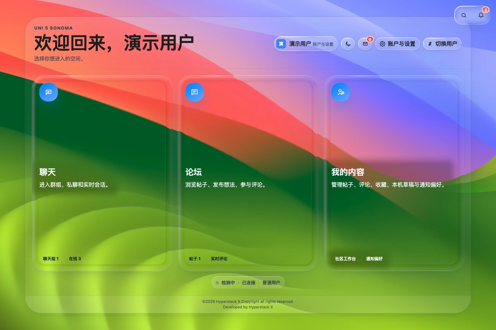
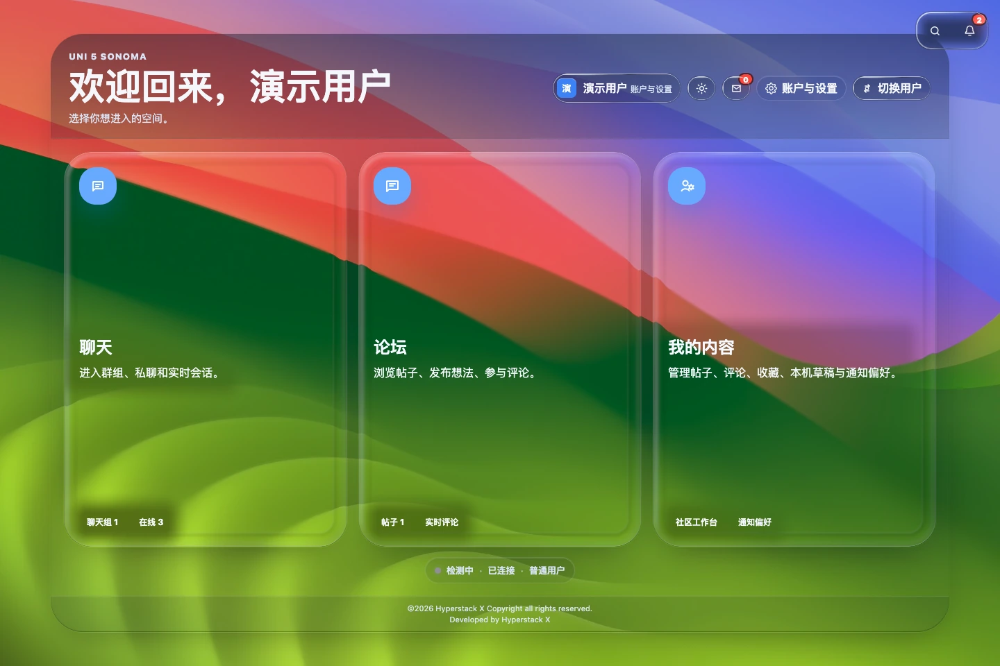
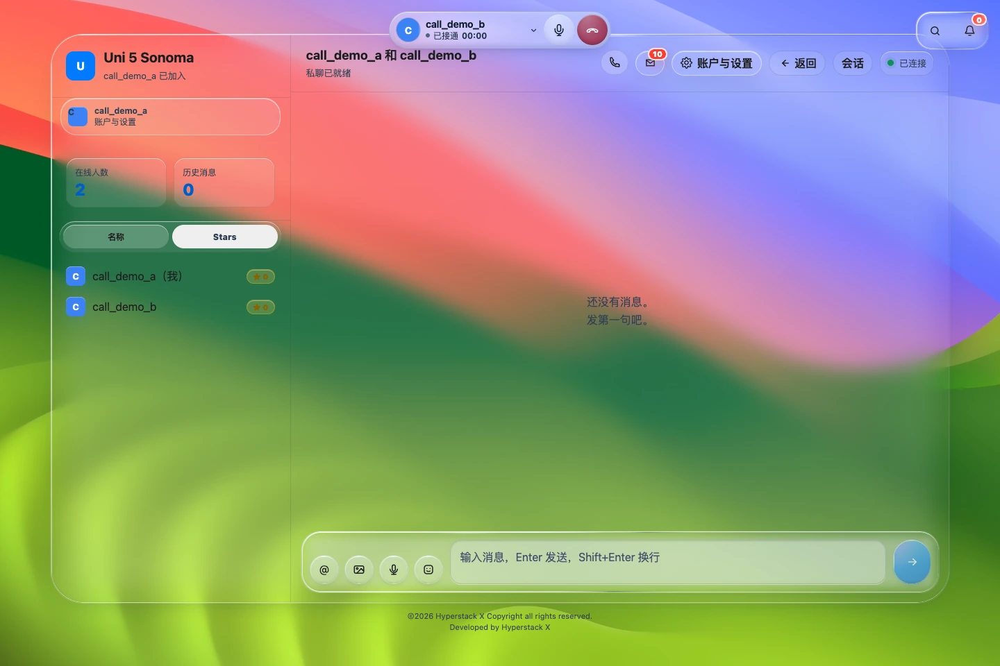
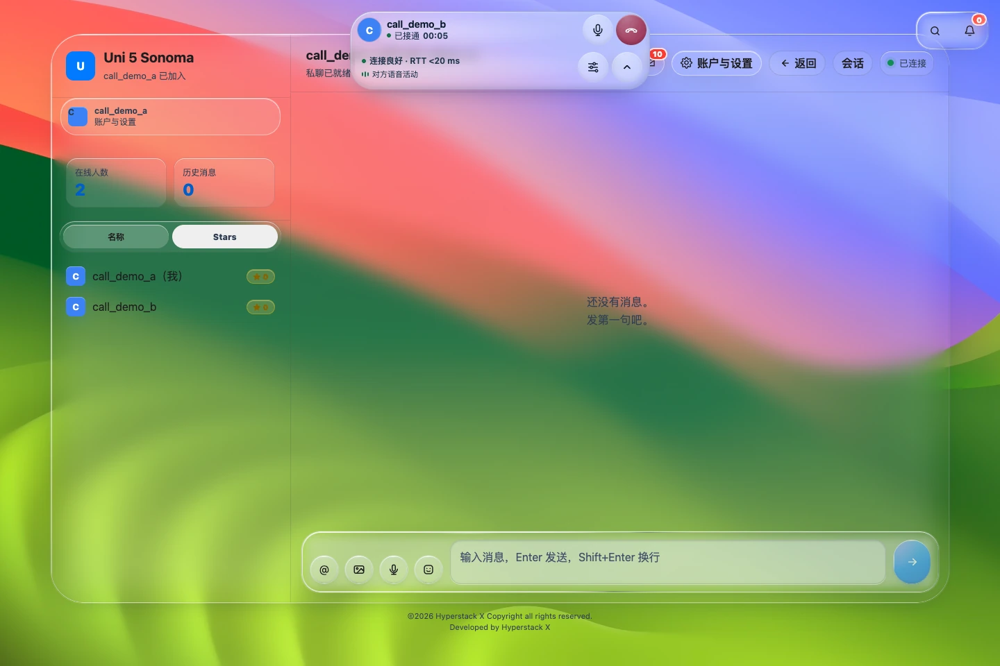
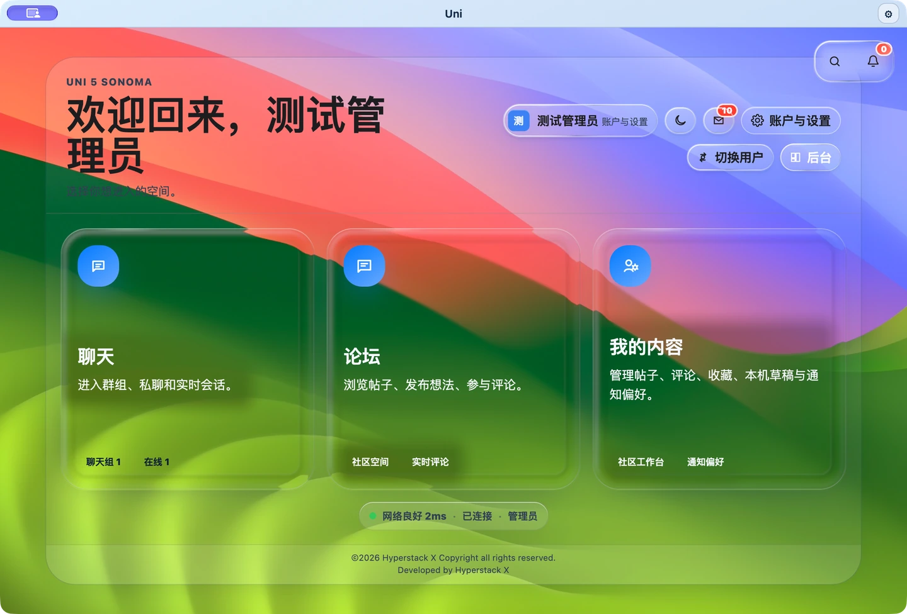
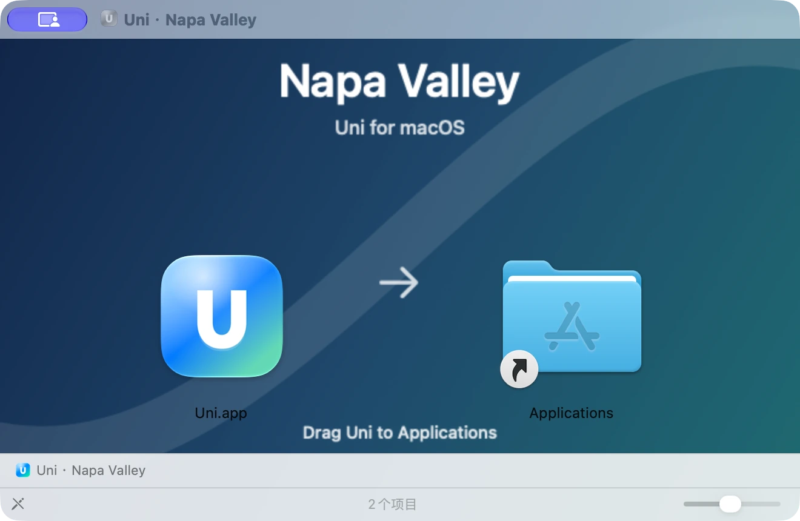

# Uni 5.6 Napa Valley

**Sonoma 世代的最终进化。**

由 Hyperstack X 设计与开发的轻量级实时通信与社区平台。

全新应用形态，真实声音，澄澈世界。

## 项目介绍

Uni 从实时文字通信平台发展为集聊天、社区、实时语音和独立客户端于一体的产品。用户可以在同一服务上进入群聊、与朋友私聊、参与论坛讨论，并在浏览应用时继续通话。Napa Valley 是 Uni 5 Sonoma 世代的最后一次重大功能更新。

## Napa Valley 三大核心革新

| 革新 | 体验 |
|---|---|
| **Uni for macOS** | Apple Silicon 独立客户端。Crystal Window 提供原生窗口控件、菜单栏、Dock 未读徽标和系统通知。首次启动可配置 Uni 服务器，登录状态保存由用户选择。 |
| **Uni Call** | 一对一 WebRTC 双向 Opus 语音。顶部水晶岛支持接听、拒绝、静音、设备选择、音量控制及跨页面通话。连接状态显示 RTT 范围，通话结束后保存记录并释放媒体资源。 |
| **Liquid Crystal** | 首页三张导航卡片通过 WebGL 重采样 Sonoma 壁纸，实现边缘折射、细微色散和局部明暗补偿。支持浅深主题、减少透明度、减少动效，以及基于 Apple 公开设计资料调整的通知交互和焦点管理。 |

首页光学层用于已知 Sonoma 壁纸。Uni Call Island 使用 CSS 背景透射和边缘高光，紧凑与展开形态之间采用可反向的 380 ms 连续过渡。

## 应用下载

| 下载 | 用途 |
|---|---|
| [Uni 5.6.0 正式发布页](https://github.com/MushinHemin/Uni-5-IOC-Developed-by-Hyperstack-X/releases/tag/v5.6.0) | 版本说明和全部附件 |
| [macOS ARM64 安装镜像](https://github.com/MushinHemin/Uni-5-IOC-Developed-by-Hyperstack-X/releases/download/v5.6.0/Uni-5.6.0-arm64.dmg) | 推荐下载，挂载后拖入「应用程序」 |
| [macOS ARM64 应用 ZIP](https://github.com/MushinHemin/Uni-5-IOC-Developed-by-Hyperstack-X/releases/download/v5.6.0/Uni-5.6.0-arm64.app.zip) | 解压后取得完整 Uni.app |
| [macOS 客户端源码](https://github.com/MushinHemin/Uni-5-IOC-Developed-by-Hyperstack-X/releases/download/v5.6.0/Uni-5.6.0-macOS-source.zip) | 桌面项目、锁文件、构建脚本和验收说明 |
| [SHA-256 校验值](https://github.com/MushinHemin/Uni-5-IOC-Developed-by-Hyperstack-X/releases/download/v5.6.0/SHA256SUMS.txt) | 核对下载文件完整性 |

客户端支持 Apple Silicon ARM64，连接已有 Uni 服务。部署自己的 Web/PWA 服务请使用本仓库源码。

## 产品功能

| 模块 | 功能 |
|---|---|
| 账户与身份 | 注册、登录、切换账户、管理员权限、封禁和更名流程 |
| 实时聊天 | 群聊、私聊、按房间历史分页、已读游标、图片、语音、引用和 Reaction |
| 实时语音 | 呼叫、接听、取消和挂断、麦克风静音、设备选择、断线恢复与历史记录 |
| 社区论坛 | 富文本编辑、图片、独立草稿、评论与回复、点赞、收藏和社区工作台 |
| 表情与资料 | 官方及个人表情、创作者流程、个人主页、资料个性化和 Star |
| 发现与通知 | 全局搜索、通知中心、公告、分类筛选、未读状态和通知偏好 |
| 社区安全 | 举报、管理员控制台、审核和账户限制 |
| 视觉设置 | 浅色、深色、跟随系统、玻璃强度、减少透明度和减少动效 |

## 产品截图

以下画面由真实浏览器和 macOS 应用生成，使用隔离测试数据。

| 页面 | 预览 |
|---|---|
| Sonoma 首页 |  |
| Liquid Crystal 光学效果 |  |
| 私聊 |  |
| Uni Call Island |  |
| macOS 独立客户端 |  |
| DMG 安装 |  |

## 支持平台

| 平台 | 当前状态 |
|---|---|
| Web | 已实现，Chromium 回归验收通过 |
| PWA | 已实现，部分移动端及独立窗口实机验收待办 |
| macOS Apple Silicon | ARM64 构建已完成，本机安装及启动已验收 |
| Windows | 未来规划，尚未发布 |
| Intel Mac、iOS | 当前无正式独立客户端 |
| Android / Capacitor | 历史工程，已停止维护 |

## 技术架构

| 层级 | 技术与职责 |
|---|---|
| Web 服务 | Node.js、Express，提供 HTTP API 和静态 Web/PWA |
| 实时通信 | Socket.IO，处理消息、通知、会话状态及 WebRTC 信令 |
| 数据 | Node 内置 SQLite，保存账户、聊天、社区和通话记录 |
| Web 界面 | HTML、CSS、JavaScript。首页 WebGL 使用 Sonoma 壁纸纹理 |
| 语音 | WebRTC、Opus、ICE，配合可配置 STUN/TURN |
| 桌面外壳 | Electron、Chromium、electron-builder，隔离远端 Uni 页面和原生能力 |

[Web API](docs/API.md) · [Uni Call 架构](docs/UNI-CALL-ARCHITECTURE.md) · [macOS 安全说明](desktop/macos/MACOS-SECURITY.md)

## macOS 安装指南

1. 从本项目的 GitHub 正式发布页下载 ARM64 DMG 和 SHA256SUMS.txt。执行 `shasum -a 256 Uni-5.6.0-arm64.dmg`，与对应校验值核对。
2. 打开 DMG，将 **Uni** 拖入 **应用程序**，再从 Finder 打开 Uni。
3. 输入可信 Uni 服务的 HTTPS 地址，例如 `https://uni.example.com`，连接后使用该服务器的 Uni 账户登录。迁移服务器时打开 **Uni → 服务器连接设置…**。
4. 来电接听、发起通话或录制语音时，按需授予麦克风权限。通知预览和关窗后后台连接可在连接设置中调整。

安装包采用本地 ad-hoc 签名，Developer ID 签名和 Apple 公证尚未完成。macOS 可能按设备策略提示或限制打开。请从官方项目仓库获取文件，校验 SHA-256，并保留系统安全保护。客户端需要连接独立部署的 Uni 服务。

[macOS 使用与构建说明](desktop/macos/README-MACOS.md)

## Web 服务端安装与部署

`.nvmrc` 固定 Node **24.22.1**，本轮在该版本完成服务端回归。`package.json` 声明 `^22.23.4 || ^24.22.1 || ^26.12.1`。生产部署使用锁定依赖，目标机器需安装符合声明的已修补 Node。

```sh
nvm install
nvm use
npm ci --omit=dev
cp .env.example .env
```

首次启动前编辑 `.env`，为新管理员配置独立强密码。以下地址为部署示例。

```dotenv
PORT=3200
ALLOWED_ORIGINS=https://uni.example.com
ADMIN_ACCOUNT=admin
ADMIN_USERNAME=平台管理员
ADMIN_PASSWORD=
```

| 配置 | 说明 |
|---|---|
| `PORT` | Node 服务监听端口 |
| `ALLOWED_ORIGINS` | 逗号分隔的允许来源，填写实际 HTTPS 服务域名 |
| `ADMIN_ACCOUNT`、`ADMIN_USERNAME` | 初始化管理员账户及显示名称 |
| `ADMIN_PASSWORD` | 引导创建缺失的管理员账户。已有管理员密码通过授权流程重置 |

执行 `npm start` 后，本机默认访问 `http://127.0.0.1:3200/`。生产环境通过受信任的 HTTPS 反向代理提供 Web、PWA 和 Socket.IO，并启用 WebSocket 升级转发。将数据库、上传目录和配置存放在访问受控的持久化位置，定期备份。[配置模板](.env.example)

## Uni Call 网络部署

HTTPS 提供安全浏览器上下文，Socket.IO 转发信令及通话状态。STUN 帮助浏览器发现连接候选地址，TURN 在双方网络无法直连时中继媒体。公网跨网络通话需要与用户网络匹配的 ICE/TURN 基础设施。按实际部署填写 `UNI_CALL_STUN_URLS`、`UNI_CALL_TURN_URLS` 和 `UNI_CALL_TURN_SECRET`。[Uni Call 和 coturn 部署指南](docs/UNI-CALL-TURN-DEPLOYMENT.md)

## 版本发展历史

| 版本 | 重要更新 |
|---|---|
| **5.6.0 Napa Valley** | Sonoma 世代最后一次重大更新。推出 macOS、Uni Call、动态水晶岛和 Liquid Crystal |
| 5.6.0-rc.1 Napa Valley | 首页光学、通知交互和实时语音的候选验收 |
| 5.5.9 Sonoma | 消息持久化、权限安全、数据完整性、媒体验证、移动布局和依赖治理 |
| 5.5.8 Sonoma | 社区工作台、草稿及通知管理 |
| 5.5.6–5.5.7 Sonoma | 富文本编辑、论坛稳定性与草稿恢复 |
| 5.5.0–5.5.5 Sonoma | 表情、附件、互动与全局搜索逐步完善 |
| 5.2–5.4 Sonoma | 社区论坛、主页、个性化、Star、审核与安全升级 |

[5.6.0 发布说明](docs/RELEASE-NOTES-5.6.0.md) · [5.6.0 更新日志](docs/CHANGELOG-5.6.0.md) · [RC1 更新日志](docs/CHANGELOG-5.6.0-rc.1.md) · [5.5.9 更新日志](docs/CHANGELOG-5.5.9.md) · [Sonoma 完整历史说明](https://github.com/MushinHemin/Uni-5-IOC-Developed-by-Hyperstack-X/blob/d4ea0436d0b8666007080fefe79963d73a39a2ac/README.md)

## 已知限制与安全说明

- Safari 完整交互和 WebRTC、iPhone Safari/PWA、真实麦克风和蓝牙音频、VoiceOver 仍待完整验收。
- 公网跨网络通话与强制 TURN 中继需在选定的部署环境验证。
- macOS 通知横幅、专注模式、长时间运行功耗和 GPU 负载仍待设备测试。
- macOS 安装包尚未完成 Developer ID 签名和 Apple 公证。正式版本号表示 Uni 产品版本。
- 部署配置、凭据、生产数据库、上传文件与备份应保留在受保护的环境。

[正式版验收报告](docs/RELEASE-READINESS-5.6.0.md)

## 关于 Hyperstack X

**Uni 5.6 Napa Valley**

Sonoma 世代的最终进化。

由 Hyperstack X 设计与开发。

Designed and developed by Hyperstack X.
